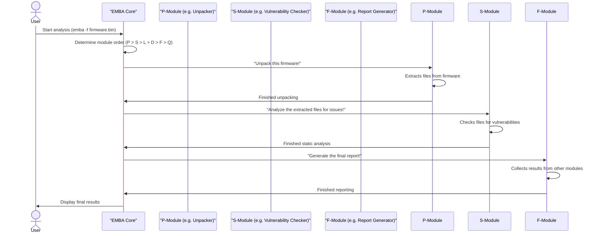

## 第〇章：EMBA模块导论

Here's a quick overview of the main categories:

| Category | Prefix                            | Purpose                                                | Example Task                                          |
| :------- | :-------------------------------- | :----------------------------------------------------- | :---------------------------------------------------- |
| **P**    | Pre-Analysis                      | Prepares the firmware, extracts files, initial scans.  | Unpacking the firmware (like a ZIP file).             |
| **S**    | Static Analysis                   | Examines files without running the code.               | Checking code for known weaknesses.                   |
| **L**    | Live Emulation (Dynamic Analysis) | Runs parts of the firmware in a simulated environment. | Testing a web interface that appears in the firmware. |
| **D**    | Diffing Analysis                  | Compares two firmware versions to find differences.    | Identifying changed files between two updates.        |
| **F**    | Final Reports                     | Generates summaries, Software Bill of Materials.       | Creating a list of all software components.           |
| **Q**    | AI (Experimental)                 | Uses AI models for advanced insights (optional).       | Asking AI questions about a suspicious code snippet.  |
|          |                                   |                                                        |                                                       |

Here’s a simplified sequence of what happens:
