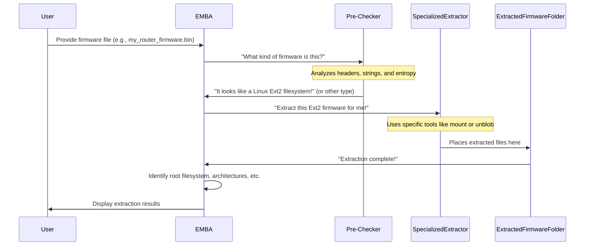

## 第一章：固件提取层


想象一下你刚买了一台新的智能设备，比如一台高级Wi-Fi路由器或一台高科技监控摄像头。这些设备运行在称为**固件**的特殊软件上。如果你想知道你的设备安全性，或者想知道它实际运行的软件组件，你不能直接“查看”它内部。固件通常像数字洋葱一样被打包，里面隐藏着多层文件和不同类型的文件。

这正是EMBA固件**提取层**发挥作用的地方！这是EMBA迈出的第一步。可以把它想象成一位细致入微的侦探小心拆解一个复杂的装置。它的任务是剥开这些数字层，识别固件镜像中的所有不同部分，并将其提取成可用格式以便更深入地检查。

本章的核心目标是理解_EMBA如何自动将单个固件文件拆解为所有独立组件_，为后续分析做准备。

### 什么是固件镜像？


固件镜像的核心是一个包含设备运行所需软件的大文件。它通常经过压缩、加密或由制造商特别格式化。

想象你有一个密封的玩具箱。里面不仅仅是玩具;里面有不同的乐高积木袋、说明书，甚至可能还有一些小工具。整个玩具盒就像你的**固件镜像**。EMBA的工作是打开这个盒子，整理里面的所有东西。

固件镜像内部的“东西”通常是：

- **文件系统**：这些是有序的文件夹和文件，类似于你电脑上看到的（例如，Linux 文件系统如 或）。`ext4` `Squashfs`
- **数据块**：这些是可能被加密、压缩或设备所需的非结构化信息的原始数据块。
- **可执行文件和库**：使设备运行的实际程序和代码。

### EMBA如何提取固件

作为用户，你不需要成为数字锁匠也能使用EMBA。你只需指向固件文件，它就能智能地处理解压过程。

#### EMBA的拆包策略：先检测，然后提取

EMBA不仅仅是尝试一种工具。其策略包括：

1. **初始识别**（预检查）：首先，尝试识别固件文件的类型。它是标准档案吗？磁盘映像？是专有软件吗？
2. **专业提取**：如果识别出已知类型，会使用特定且最合适的工具进行拆封。
3. **通用提取**：如果某个专用模块无效或仅部分成功，EMBA会使用强大的通用拆包器，尝试提取任何能提取的部分。`unblob` `binwalk`
4. **深度提取**（递归解包）：有些固件包就像“套娃”——包裹里套包，包裹又包裹包裹！如果没有立即找到Linux根文件系统，EMBA会递归地尝试提取第一层内的文件，然后是第二层的文件，如此反复，直到找到根文件系统或选项用尽。

让我们看看实际操作中的效果如何。

要开始用EMBA进行分析，通常会执行如下命令：

```shell
./emba -f my_router_firmware.bin -l ~/your_log_directory
```

当你执行这个命令时，EMBA会自动激活其固件提取层。它将首先检查，识别其类型，然后使用最合适的工具提取其内容物。你会在屏幕上看到描述EMBA检测结果的输出，比如：`my_router_firmware.bin`

```
[+] Identified Linux ext2 filesytem - using EXT filesytem extraction module
[*] Extracting firmware to directory /logs/firmware/unblob_extracted
```

这说明 EMBA 识别了某种特定类型的文件系统，并正在提取它。

### 引擎盖下：提取过程


让我们一窥幕后，看看EMBA的固件提取层是如何发挥它的神奇作用的。

该过程可视为一系列步骤：




#### 1.初始检查（预检查）：

EMBA首先运行一个“预检查”模块（`P02_firmware_bin_file_check.sh`）。这个模块就像一个快速扫描器，会检查固件文件的特性（比如文件类型、校验和初始字节），以猜测它可能使用的固件类型。

以下是EMBA如何检测固件类型的简化说明：

```bash
# From modules/P02_firmware_bin_file_check.sh
# Simplified version of fw_bin_detector function
fw_bin_detector() {
  local lCHECK_FILE="${1:-}"
  local lFILE_BIN_OUT # Stores output of 'file' command

  # Use the 'file' command to identify the file type
  lFILE_BIN_OUT=$(file "${lCHECK_FILE}")

  # Check for specific patterns in the file output
  if [[ "${lFILE_BIN_OUT}" == *"Linux rev 1.0 ext2 filesystem data"* ]]; then
    # If it's an Ext2 filesystem, set a flag for other modules
    print_output "[+] Identified Linux ext2 filesytem"
    export EXT_IMAGE=1 # This variable tells EMBA to use the Ext extractor
  elif [[ "${lFILE_BIN_OUT}" == *"VMware4 disk image"* ]]; then
    # If it's a VMDK image, set another flag
    print_output "[+] Identified VMWware VMDK archive file"
    export VMDK_DETECTED=1 # This flag triggers the VMDK extractor
  # ... other detection logic for different types
  fi
}
```

根据 `file`（用于识别文件类型的常用 Linux 命令）报告或其他内部检查，EMBA 会设置内部标志（如 EXT_IMAGE=1 或 VMDK_DETECTED=1）。这些标志作为信号，提示下一步应激活专用的提取模块。EMBA还会生成固件的视觉“熵图”，有时可以揭示隐藏的加密部分。

#### 2.专用提取：

一旦EMBA确定固件类型，就会调用其众多专用提取模块之一。每个模块设计用于处理特定的固件格式或加密方案。

以下是一些具体提取器及其功能示例：

- **EXT文件系统解压器（`P14_ext_mounter.sh`）**
- **Windows 可执行解压器（`P07_windows_exe_extract.sh`）**
- **Foscam解密器（`P20_foscam_decryptor.sh`）**
- **Unblob Extractor （`P55_unblob_extractor.sh`）**
- **Binwalk Extractor（`P50_binwalk_extractor.sh`）**
- **深度提取器（`P60_deep_extractor.sh`）**

#### 3.取出后组织与分析：
 
初次取出后，EMBA尚未完成。接着：
    
    - **修复权限和符号链接**：固件镜像在解压后常常丢失文件权限或符号链接断裂。辅助脚本修复这些问题，使提取后的文件更易用于后续分析。`helpers/fix_bins_lnk_emulation.sh`
    - **识别根目录**：EMBA 尝试通过 找到 Linux 文件系统“主”部分在提取数据中的位置。这对于高效操作提取的固件至关重要。`helpers/helpers_emba_prepare.sh`
    - **分析架构**：它扫描提取的可执行文件，以确定其CPU架构（如ARM、MIPS、x86）和字序值（数据存储在内存中的方式）。这些信息对于后续步骤如模拟至关重要。

固件提取层设计为全面，确保 EMBA 能够获得设备内部软件的最完整视图。

整个过程都是自动化的。你给EMBA输入固件文件，它会自动应用“解包”团队来准备分析。

### 常见的固件类型和解压器


这里有一张表格，总结了EMBA可以提取的一些常见固件类型及其使用的模块/工具：

| Firmware Type                                     | Key Detection Clue                   | Primary Extractor Module     | Core Tool/Method                   |
| :------------------------------------------------ | :----------------------------------- | :--------------------------- | :--------------------------------- |
| Generic Binary Firmware                           | Any binary blob                      | `P55_unblob_extractor.sh`    | `unblob`                           |
| Generic Binary Firmware                           | Any binary blob                      | `P50_binwalk_extractor.sh`   | `binwalk v3`                       |
| Linux Filesystem`extX`                            | `file` output contains "extX"        | `P14_ext_mounter.sh`         | `mount`                            |
| VMware VMDK Image                                 | `file` output contains "VMware"      | `P10_vmdk_extractor.sh`      | `guestmount`, `7z`                 |
| UEFI/BIOS Firmware                                | Strings like "UEFI", "BIOS"          | `P35_UEFI_extractor.sh`      | `UEFITool`, `uefi-firmware-parser` |
| DJI Drone Firmware                                | Specific header strings like "PRAK"  | `P40_DJI_extractor.sh`       | `dji-firmware-tools`, `unblob`     |
| Windows Executable (`.exe`)                       | `file` output contains "PE32"        | `P07_windows_exe_extract.sh` | `7z`                               |
| Android OTA (`payload.bin`)                       | Magic bytes "CrAU"                   | `P25_android_ota.sh`         | `payload_dumper.py`                |
| UBI Filesystem                                    | `file` output contains "UBI image"   | `P15_ubi_extractor.sh`       | `ubireader`                        |
| Zyxel Encrypted ZIP                               | `.ri` file + specific ELF executable | `P22_Zyxel_zip_decrypt.sh`   | `qemu-user`, `7z`                  |
| QEMU QCOW2 Image                                  | `file` output contains "QEMU QCOW2"  | `P23_qemu_qcow_mounter.sh`   | `qemu-nbd`                         |
| Compressed (GPG) Firmware                         | Specific GPG header bytes            | `P17_gpg_decompress.sh`      | `gpg`                              |
| Package Archives (, , , `.deb``.apk``.ipk``.rpm`) | Filename extension, file type        | `P65_package_extractor.sh`   | `dpkg-deb`, , `unzip``cpio`        |

### 结论


固件提取层是EMBA分析的基础步骤。通过自动且智能地剖析复杂的固件映像，EMBA 将一个原始且常常无法使用的二进制数据块转变为一个结构井然的文件和目录集合。这使得后续分析阶段能够处理有意义的数据，发现漏洞并提供详细的洞察。

现在 EMBA 已经成功提取并整理了固件组件，下一步是详细检查其内容，而无需运行它们。这正是[分析核心](https://github.com/e-m-b-a/emba/wiki/The-EMBA-book-%E2%80%90-Chapter-2%3A-Analysis-Core)发挥作用的地方。
