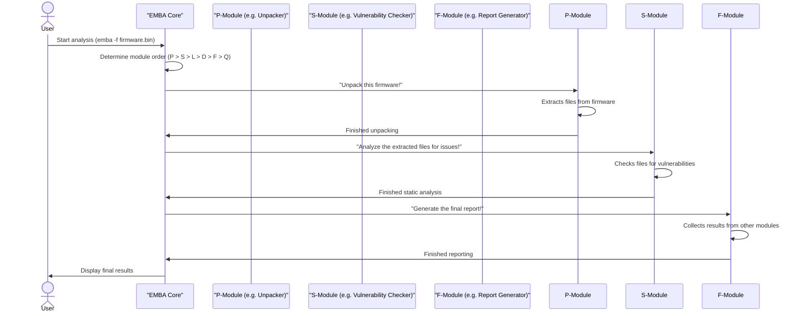

# Chapter 0: Introduction into EMBA Modules

Welcome back, firmware adventurers! In _Chapter -1: Installation & Environment Management (coming soon)_, you successfully set up your EMBA workbench, making sure all the necessary tools were installed and ready. Now, it's time to meet the actual "tools" that do the heavy lifting: EMBA Modules, also known as Analysis Units.

## Your Specialized Toolkit: What are EMBA Modules?

Imagine you're a detective, and a mysterious black box (your firmware file) has just landed on your desk. To uncover its secrets, you'll need many different investigative techniques: dusting for fingerprints, analyzing handwriting, checking financial records, and so on.

EMBA Modules are like these specialized detective tools. Instead of having one giant tool that tries to do everything (which would be confusing and inefficient!), EMBA breaks down the complex process of firmware analysis into many smaller, focused "apps" or "scripts." Each module is designed to do one specific job really well.

**Why is this helpful?**
*   **Focus:** Each module can concentrate on its task without worrying about others.
*   **Flexibility:** You can choose to run only the modules you need, making your analysis faster and more targeted.
*   **Organization:** It keeps the entire analysis process structured and easy to understand.

**Let's think of a concrete use case:**
You have a firmware update for a smart camera, and you want to know if it's safe. This isn't just one step; you need to:
1.  **Unpack** the firmware to see its contents.
2.  **Inspect** the code for known vulnerabilities.
3.  **Identify** all the third-party software components.
4.  Maybe even **run** parts of the firmware in a safe, simulated environment to see how they behave.

Each of these steps (and many more!) is handled by a different EMBA module.

## Understanding the Modules: The EMBA Toolbox Categories

EMBA organizes its modules into different categories, like different sections in a well-organized toolbox. This helps you understand when each tool is used during the analysis process.

Here's a quick overview of the main categories:

| Category | Prefix | Purpose                                                         | Example Task                                    |
| :------- | :----- | :-------------------------------------------------------------- | :---------------------------------------------- |
| **P**    | Pre-Analysis                                                        | Prepares the firmware, extracts files, initial scans.  | Unpacking the firmware (like a ZIP file).        |
| **S**    | Static Analysis                                                     | Examines files without running the code.         | Checking code for known weaknesses.              |
| **L**    | Live Emulation (Dynamic Analysis)                                   | Runs parts of the firmware in a simulated environment. | Testing a web interface that appears in the firmware. |
| **D**    | Diffing Analysis                                                    | Compares two firmware versions to find differences. | Identifying changed files between two updates.   |
| **F**    | Final Reports                                                       | Generates summaries, Software Bill of Materials. | Creating a list of all software components.      |
| **Q**    | AI (Experimental)                                                   | Uses AI models for advanced insights (optional). | Asking AI questions about a suspicious code snippet. |

You'll notice that each module's filename starts with one of these letters followed by a number (e.g., `P55_unblob_extractor.sh`, `L25_web_checks.sh`). This helps EMBA know when to run them and what their general purpose is.

## How EMBA Uses Modules: Running an Analysis

When you run EMBA on a firmware file, it intelligently selects and executes the relevant modules in the correct order.

Let's say you want to analyze `my_camera_firmware.bin`. You would typically run EMBA like this:

```bash
emba -f my_camera_firmware.bin
```

**What happens next?**
EMBA will go through its module categories, starting with 'P' (Pre-Analysis), then 'S' (Static Analysis), and so on. For each category, it will run the modules that are applicable to your firmware.

You'll see output in your terminal indicating which module is currently running:

```
[+] Running module P05_firmware_unpacker...
[*] Initializing P05_firmware_unpacker...
[+] Running module P55_unblob_extractor...
[*] Extracting binary blob my_camera_firmware.bin to directory ...
[+] Running module S01_checksum_collector...
[*] Collecting checksums...
# ... many more modules ...
[+] Running module F15_cyclonedx_sbom...
[*] Generating SBOM...
```

This output shows EMBA systematically applying its tools to your firmware.

## Under the Hood: How Modules Work

To understand modules better, let's peek at what happens when EMBA runs them and how they are structured.

### The Module Workflow: A Step-by-Step Look

When you launch EMBA, it orchestrates the modules. Think of EMBA as a project manager, assigning tasks to different experts (the modules).

Here’s a simplified sequence of what happens:


As you can see, EMBA ensures each module runs, completes its task, and provides its findings before the next relevant stage begins.

### The Structure of an EMBA Module

Every EMBA module is a self-contained shell script. While they can get quite complex inside, they all follow a basic structure, like a standard recipe card for a kitchen tool.

Let's look at a simplified template from EMBA's codebase (`modules/template_module.sh`):

```bash
template_module() {
  # 1. Initialize the module and its log file
  module_log_init "${FUNCNAME[0]}"
  # 2. Display the module's title to the user and in logs
  module_title "Empty module"

  # 3. This is where the module's unique analysis tasks go!
  #    It might call other helper functions or external tools.
  print_output "[*] This module does nothing, it's just a template."

  # 4. End the module and record its status/findings
  module_end_log "${FUNCNAME[0]}" "${#COUNT_FINDINGS[@]}"
}
```
**Explanation:**
*   `module_log_init`: This function prepares a dedicated log file and directory for the module. It's like preparing a clean workspace for your tool.
*   `module_title`: This displays the module's name in your terminal and logs, so you always know which tool is currently at work.
*   The middle part is where the actual work happens. This is unique to each module.
*   `module_end_log`: This signals that the module has finished and records whether it found anything important. It's like putting the tool back in the box and noting down what you found.

### Real-World Module Examples

Let's quickly look at how this structure is applied in actual EMBA modules.

#### 1. Pre-Analysis: Unpacking Firmware (`P55_unblob_extractor.sh`)

This module is responsible for extracting files from the raw firmware image. It's a crucial first step!

```bash
P55_unblob_extractor() {
  module_log_init "${FUNCNAME[0]}"
  module_title "Unblob binary firmware extractor" # Clearly states its purpose

  # ... (internal logic to check if extraction is needed, handle directories, etc.) ...

  # This line calls the 'unblob' tool to do the actual unpacking
  unblobber "${lFW_PATH_UNBLOB}" "${lOUTPUT_DIR_UNBLOB}" 0

  # ... (further processing of extracted files, like identifying architectures) ...

  module_end_log "${FUNCNAME[0]}" "${#lFILES_UNBLOB_ARR[@]}"
}
```
**Explanation:** After initialization, this module uses the external `unblob` tool to decompress and extract the firmware's contents. It then reports how many files were found.

#### 2. Live Emulation: Web Checks (`L25_web_checks.sh`)

If EMBA manages to run parts of the firmware in a simulated environment, this module will check if any web servers are running and if they have common vulnerabilities.

```bash
L25_web_checks() {
  # Only run if a system is online and network is ok
  if [[ "${SYS_ONLINE}" -eq 1 ]] && [[ "${TCP}" == "ok" ]]; then
    module_log_init "${FUNCNAME[0]}"
    module_title "Web server analysis of emulated device" # Purpose on a running system

    # ... (internal logic to get the emulated system's IP address) ...

    # This function performs various web-related tests
    main_web_check "${IP_ADDRESS_}"

    # ... (logging and statistics) ...
    module_end_log "${FUNCNAME[0]}" "${WEB_RESULTS}"
  fi
}
```
**Explanation:** This module first checks if a simulated system is running and reachable. If so, it calls `main_web_check` which, in turn, uses tools like `nikto.pl` or `testssl.sh` to poke at any detected web services.

#### 3. Final Report: SBOM Generation (`F15_cyclonedx_sbom.sh`)

After all the analysis is done, this module compiles a Software Bill of Materials (SBOM), a comprehensive list of all software components found in the firmware.

```bash
F15_cyclonedx_sbom() {
  module_log_init "${FUNCNAME[0]}"
  module_title "CycloneDX SBOM generator" # Generates a key report

  # ... (gathers information about detected software components from other modules) ...

  # This line builds the final JSON SBOM using collected data
  jo -p -n -- \$schema="${lSBOM_SCHEMA}" ... > "${lSBOM_LOG_FILE}.json"

  # ... (converts the SBOM to other formats like XML or SPDX) ...

  module_end_log "${FUNCNAME[0]}" "${lNEG_LOG}"
}
```
**Explanation:** This module doesn't perform new analysis itself but rather collects and organizes data generated by many other modules. It uses a tool called `jo` to create a structured JSON file that details all identified software components, their versions, and other important information.

#### 4. AI Analysis: OpenAI Questions (`Q02_openai_question.sh`)

This experimental module leverages Artificial Intelligence (AI) to ask questions about code snippets or findings from other modules.

```bash
Q02_openai_question() {
  # Only runs if OpenAI is enabled and an API key is provided
  if [[ "${GPT_OPTION}" -gt 0 ]] && [[ -n "${OPENAI_API_KEY}" ]]; then
    module_log_init "${FUNCNAME[0]}"
    module_title "AI analysis via OpenAI" # Interacts with AI for insights

    # This loop continuously checks for questions from other modules
    while ! grep -q "Testing phase ended" "${LOG_DIR}"/"${MAIN_LOG_FILE}"; do
      ask_chatgpt # Function to query the AI with identified questions
      sleep 2
    done

    # ... (cleans up and finishes) ...
    module_end_log "${FUNCNAME[0]}" "${CHATGPT_RESULT_CNT}"
  fi
}
```
**Explanation:** This module acts as an intelligent assistant. It constantly monitors for questions generated by other EMBA modules (e.g., "What does this suspicious code do?"). When a question is found, it sends the relevant information to an AI (like OpenAI's ChatGPT) and logs the response.

## Conclusion

You've now taken a deep dive into EMBA Modules, understanding them as the specialized, individual tools that make up EMBA's powerful analysis capabilities. You've learned how they are categorized to structure the entire firmware security scanning process and seen how they work together, orchestrated by the EMBA core.

With your workbench ready and a grasp of EMBA's modular toolkit, you're prepared for the next exciting step: getting the raw firmware ready for these tools to analyze. In the [Next Chapter: Firmware Extraction](The-EMBA-book-‐-Chapter-1%3A-Firmware-Extraction-Layer), we'll explore how EMBA unpacks and prepares your firmware files.