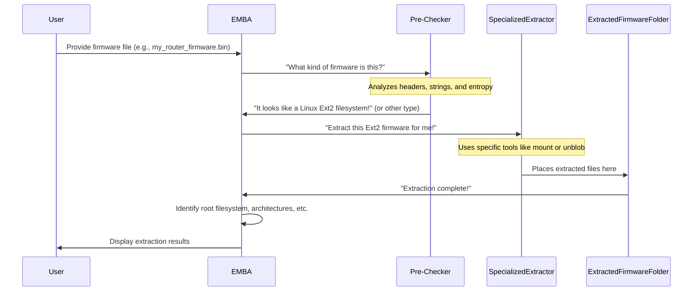

# Chapter 1: Firmware Extraction Layer

Imagine you've just bought a new smart device, like a fancy Wi-Fi router or a high-tech security camera. These devices run on special software called **firmware**. If you're curious about how secure your device is, or if you want to find out what software components it's truly running, you can't just "look inside" it directly. The firmware is usually packed up like a digital onion, with many layers and different types of files hidden within.

This is where EMBA's **Firmware Extraction Layer** comes in! It's the very first crucial step EMBA takes. Think of it like a meticulous detective carefully taking apart a complex device. Its job is to peel back these digital layers, identify all the different parts inside the firmware image, and extract them into a usable format for deeper inspection.

Our central goal in this chapter is to understand *how EMBA automatically takes a single firmware file and breaks it down into all its individual components*, preparing them for later analysis.

### What is a Firmware Image?

At its heart, a firmware image is just one big file that contains all the software a device needs to operate. It's often compressed, encrypted, or specially formatted by the manufacturer.

Imagine you have a sealed toy box. Inside, there aren't just toys; there are different bags of LEGO bricks, an instruction manual, and maybe even a few small tools. The entire toy box is like your **firmware image**. EMBA's job is to open this box and sort out everything inside.

The "things inside" the firmware image are often:

*   **Filesystems**: These are like organized folders and files, similar to what you find on your computer (e.g., Linux filesystems like `ext4` or `Squashfs`).
*   **Data Blobs**: These are chunks of raw data that might be encrypted, compressed, or just unstructured information the device needs.
*   **Executables and Libraries**: The actual programs and code that make the device work.

### How EMBA Extracts Firmware

You, as the user, don't need to be a digital locksmith to use EMBA. You simply point EMBA to your firmware file, and it intelligently handles the extraction process.

#### EMBA's Unpacking Strategy: Detect, Then Extract

EMBA doesn't just try one tool. It has a strategy that involves:

1.  **Initial Identification (Pre-checking)**: First, it tries to identify the type of firmware file. Is it a standard archive? A disk image? Something proprietary?
2.  **Specialized Extraction**: If it identifies a known type, it uses a specific, best-suited tool to unpack it.
3.  **General-Purpose Extraction**: If one of the specialized modules don't work or only partially succeed, EMBA uses powerful general-purpose unpackers like `unblob` or `binwalk` to try and extract whatever they can.
4.  **Deep Extraction (Recursive Unpacking)**: Some firmware packages are like "Matryoshka dolls" – a package inside a package, inside another package! If a Linux root filesystem isn't immediately found, EMBA will recursively try to extract files found within the first layer, then files from the second layer, and so on, until it finds a root filesystem or runs out of options.

Let's see how this works in practice.

To start an analysis with EMBA, you would typically run a command like this:

```bash
./emba -f my_router_firmware.bin -l ~/your_log_directory
```

When you run this command, EMBA automatically activates its Firmware Extraction Layer. It will begin by inspecting `my_router_firmware.bin`, identifying its type, and then using the most suitable tools to extract its contents. You'll see output on your screen describing what EMBA finds, such as:

```text
[+] Identified Linux ext2 filesytem - using EXT filesytem extraction module
[*] Extracting firmware to directory /logs/firmware/unblob_extracted
```

This tells you EMBA recognized a specific type of filesystem and is now extracting it.

### Under the Hood: The Extraction Process

Let's peek behind the curtain to see how EMBA’s Firmware Extraction Layer works its magic.

The process can be visualized as a sequence of steps:



1.  **Initial Inspection (Pre-Checking)**: EMBA first runs a "pre-checking" module (`P02_firmware_bin_file_check.sh`). This module is like a quick scanner that examines the firmware file's characteristics (like its file type, checksums, and initial bytes) to guess what kind of firmware it might be.

    Here's a simplified look at how EMBA might detect a firmware type:

    ```bash
    # From modules/P02_firmware_bin_file_check.sh
    # Simplified version of fw_bin_detector function
    fw_bin_detector() {
      local lCHECK_FILE="${1:-}"
      local lFILE_BIN_OUT # Stores output of 'file' command

      # Use the 'file' command to identify the file type
      lFILE_BIN_OUT=$(file "${lCHECK_FILE}")

      # Check for specific patterns in the file output
      if [[ "${lFILE_BIN_OUT}" == *"Linux rev 1.0 ext2 filesystem data"* ]]; then
        # If it's an Ext2 filesystem, set a flag for other modules
        print_output "[+] Identified Linux ext2 filesytem"
        export EXT_IMAGE=1 # This variable tells EMBA to use the Ext extractor
      elif [[ "${lFILE_BIN_OUT}" == *"VMware4 disk image"* ]]; then
        # If it's a VMDK image, set another flag
        print_output "[+] Identified VMWware VMDK archive file"
        export VMDK_DETECTED=1 # This flag triggers the VMDK extractor
      # ... other detection logic for different types
      fi
    }
    ```
    Based on what `file` (a common Linux command for identifying file types) reports or other internal checks, EMBA sets internal flags (like `EXT_IMAGE=1` or `VMDK_DETECTED=1`). These flags act as signals for which specialized extractor modules should be activated next. EMBA also generates a visual "entropy graph" of the firmware, which can sometimes reveal hidden encrypted sections.

2.  **Specialized Extraction**: Once EMBA has a good idea of the firmware's type, it calls upon one of its many specialized extraction modules. Each module is designed to handle a particular firmware format or encryption scheme.

    Here are a few examples of specific extractors and what they do:

    *   **EXT Filesystem Extractor (`P14_ext_mounter.sh`)**: If EMBA detects a Linux `ext2`, `ext3`, or `ext4` filesystem, this module will "mount" it (make it accessible like a regular folder) and copy its contents.

        ```bash
        # From modules/P14_ext_mounter.sh (simplified)
        ext_extractor() {
          local lEXT_PATH_="${1:-}"
          local lTMP_EXT_MOUNT="${TMP_DIR}/ext_mount_${RANDOM}"

          mkdir -p "${lTMP_EXT_MOUNT}"
          print_output "[*] Trying to mount ${lEXT_PATH_} to ${lTMP_EXT_MOUNT} directory"
          # Mounts the image read-only
          mount -o ro "${lEXT_PATH_}" "${lTMP_EXT_MOUNT}"
          # If successful, copy files to the extraction directory
          if mount | grep -q ext_mount; then
            cp -pri "${lTMP_EXT_MOUNT}"/* "${lEXTRACTION_DIR_}"
            umount "${lTMP_EXT_MOUNT}" # Unmount after copying
          fi
        }
        ```
        This snippet shows how the module creates a temporary mount point, mounts the filesystem image there, copies the contents, and then cleans up by unmounting it.

    *   **Windows Executable Extractor (`P07_windows_exe_extract.sh`)**: If the firmware contains Windows `.exe` or `.msi` files (common in some IoT devices), EMBA uses `7z` to extract them.

        ```bash
        # From modules/P07_windows_exe_extract.sh (simplified)
        exe_extractor() {
          local lFIRMWARE_PATH="${1:-}"
          local lEXTRACTION_DIR="${2:-}"

          mkdir "${lEXTRACTION_DIR}"
          print_output "[*] Extracting with 7z to ${lEXTRACTION_DIR}"
          # Extracts the contents of the Windows executable/installer
          7z x -o"${lEXTRACTION_DIR}" "${lFIRMWARE_PATH}"
        }
        ```
        This command is like unzipping a regular archive, but it's specifically for Windows executable formats.

    *   **Foscam Decryptor (`P20_foscam_decryptor.sh`)**: For encrypted firmware from specific vendors like Foscam, EMBA might try a known decryption method using tools like `openssl` with pre-defined keys.

        ```bash
        # From modules/P20_foscam_decryptor.sh (simplified)
        foscam_enc_extractor() {
          local lFOSCAM_ENC_PATH_="${1:-}"
          local lEXTRACTION_FILE_="${2:-}"
          local l_FOSCAM_KEY="your_secret_key" # Example key

          print_output "[*] Testing FOSCAM decryption key ${l_FOSCAM_KEY}."
          # Tries to decrypt the file with a known key
          openssl enc -d -aes-128-cbc -md md5 -k "${l_FOSCAM_KEY}" \
            -in "${lFOSCAM_ENC_PATH_}" > "${lEXTRACTION_FILE_}"
        }
        ```
        This shows EMBA attempting to decrypt a Foscam firmware file using a specific algorithm (`aes-128-cbc`) and a known key.

    *   **Unblob Extractor (`P55_unblob_extractor.sh`)**: This is a powerful, generic extraction module that acts as EMBA's primary "go-to" tool. If other specialized extractors don't apply or fail, `unblob` is often used as a robust fallback. It can identify and extract various embedded formats.

        Beside `unblob` EMBA also uses `binwalk` as the second generic firmware extraction framework:

        | Unpacker Tool | What it Does Best                                      | Analogy                                        |
        | :------------ | :----------------------------------------------------- | :--------------------------------------------- |
        | **Binwalk**   | Identifies and extracts embedded files and filesystems within a firmware. Great for finding hidden structures and recursing. |         A multi-tool with many specialized openers.     |
        | **Unblob**    | A powerful, modern binary blob extractor designed to handle many complex and custom formats automatically. | An advanced robot that intelligently disassembles complex devices. |


        ```bash
        # From modules/P55_unblob_extractor.sh (simplified)
        unblobber() {
          local lFIRMWARE_PATH="${1:-}"
          local lOUTPUT_DIR_UNBLOB="${2:-}"

          mkdir -p "${lOUTPUT_DIR_UNBLOB}"
          print_output "[*] Extracting with unblob to ${lOUTPUT_DIR_UNBLOB}"
          # The core unblob command for deep extraction
          unblob -k -e "${lOUTPUT_DIR_UNBLOB}" "${lFIRMWARE_PATH}"
        }
        ```
        The `unblob` tool attempts to find and extract many different types of nested files within a firmware image. The `-k` flag tells it to keep going even if it encounters errors, ensuring a thorough extraction.

    *   **Binwalk Extractor (`P50_binwalk_extractor.sh`)**:

        The `binwalker_matryoshka` function (from `helpers/helpers_emba_extractors.sh`) wraps the `binwalk` command:

        ```bash
        # Simplified from helpers/helpers_emba_extractors.sh
        binwalker_matryoshka() {
          local lFIRMWARE_PATH="${1:-}"       # Path to the firmware file
          local lOUTPUT_DIR_BINWALK="${2:-}" # Directory for extracted files

          print_output "[*] Extracting firmware with binwalk..."

          # This is the core binwalk command:
          "${BINWALK_BIN[@]}" -v -e -c -M -d "${lOUTPUT_DIR_BINWALK}" "${lFIRMWARE_PATH}"
          # -e: Extracts all files
          # -c: Carves known file types (e.g., JPEGs)
          # -M: Enables "Matryoshka" mode for recursive extraction
          # -d: Specifies the output directory
          # ... more options and error handling ...
        }
        ```

        This command tells `binwalk` to go deep (`-M` for Matryoshka mode) and extract everything it finds (`-e`).

    *   **Deep Extractor (`P60_deep_extractor.sh`)**: This module is the "last resort" and tries *multiple rounds* of extraction on *every* file found so far. It ensures that even deeply nested or unusually packed components are uncovered.

        EMBA doesn't stop at one layer. It performs **deep extraction** (`P60_deep_extractor.sh`) by repeatedly scanning and extracting files found within the firmware. If a new archive or compressed file is found *inside* an already extracted layer, EMBA will try to unpack that as well. This is how it handles the "Matryoshka doll" effect.

        Additionally, firmware often contains common package formats like Debian packages (`.deb`), Android packages (`.apk`), or OpenWrt packages (`.ipk`). The `P65_package_extractor.sh` module specifically identifies and extracts these, adding their contents to the overall extracted filesystem.

        For instance, here's a simplified look at how `P65_package_extractor.sh` might handle a Debian package:

        ```bash
        # Simplified from modules/P65_package_extractor.sh
        deb_extractor() {
          local lDEB_ARCHIVES_ARR=() # List of .deb files found

          print_output "[*] Identifying Debian archives..."
          # Finds all .deb files in the extracted firmware
          mapfile -t lDEB_ARCHIVES_ARR < <(find "${FIRMWARE_PATH_CP}" -name "*.deb")

          if [[ "${#lDEB_ARCHIVES_ARR[@]}" -gt 0 ]]; then
            print_output "[*] Found ${#lDEB_ARCHIVES_ARR[@]} Debian archives - extracting them..."
            for lDEB in "${lDEB_ARCHIVES_ARR[@]}"; do
              local lR_PATH="${FIRMWARE_PATH_CP}" # Extract to the main firmware directory
              print_output "[*] Extracting $(basename "${lDEB}") to ${lR_PATH}"
              # Uses dpkg-deb to extract the package contents
              dpkg-deb --extract "${lDEB}" "${lR_PATH}" || true
            done
          fi
        }
        ```

        This snippet shows how EMBA specifically targets common package types to ensure every possible layer is uncovered.

3.  **Post-Extraction Organization and Analysis**: After the initial extraction, EMBA isn't done. It then:
    *   **Fixes permissions and symlinks**: Firmware images often lose file permissions or have broken symbolic links after extraction. Helper scripts like `helpers/fix_bins_lnk_emulation.sh` fix these issues, making the extracted files more usable for later analysis.
    *   **Identifies root directories**: EMBA tries to figure out where the "main" part of the Linux filesystem is within the extracted data using `helpers/helpers_emba_prepare.sh`. This is crucial for navigating the extracted firmware efficiently.
    *   **Analyzes architectures**: It scans the extracted executable files to determine their CPU architecture (e.g., ARM, MIPS, x86) and endianness (how data is stored in memory). This information is vital for later steps like emulation.

The Firmware Extraction Layer is designed to be comprehensive, ensuring that EMBA gets the most complete view possible of the device's internal software.

This entire process is automated. You feed EMBA a firmware file, and it automatically applies its "unpacker" team to get it ready for analysis.

### Common Firmware Types and Extractors

Here's a table summarizing some of the common firmware types EMBA can extract and the modules/tools it uses:

| Firmware Type             | Key Detection Clue                   | Primary Extractor Module   | Core Tool/Method |
| :------------------------ | :----------------------------------- | :------------------------- | :--------------- |
| Generic Binary Firmware   | Any binary blob                      | `P55_unblob_extractor.sh`  | `unblob`         |
| Generic Binary Firmware   | Any binary blob                      | `P50_binwalk_extractor.sh`  | `binwalk v3`         |
| Linux `extX` Filesystem   | `file` output contains "extX"        | `P14_ext_mounter.sh`       | `mount`          |
| VMware VMDK Image         | `file` output contains "VMware"      | `P10_vmdk_extractor.sh`    | `guestmount`, `7z`|
| UEFI/BIOS Firmware        | Strings like "UEFI", "BIOS"          | `P35_UEFI_extractor.sh`    | `UEFITool`, `uefi-firmware-parser`|
| DJI Drone Firmware        | Specific header strings like "PRAK"  | `P40_DJI_extractor.sh`     | `dji-firmware-tools`, `unblob`|
| Windows Executable (`.exe`) | `file` output contains "PE32"        | `P07_windows_exe_extract.sh` | `7z`             |
| Android OTA (`payload.bin`) | Magic bytes "CrAU"                   | `P25_android_ota.sh`       | `payload_dumper.py`|
| UBI Filesystem            | `file` output contains "UBI image"   | `P15_ubi_extractor.sh`     | `ubireader`      |
| Zyxel Encrypted ZIP       | `.ri` file + specific ELF executable | `P22_Zyxel_zip_decrypt.sh` | `qemu-user`, `7z`|
| QEMU QCOW2 Image          | `file` output contains "QEMU QCOW2"  | `P23_qemu_qcow_mounter.sh` | `qemu-nbd`       |
| Compressed (GPG) Firmware | Specific GPG header bytes            | `P17_gpg_decompress.sh`    | `gpg`            |
| Package Archives (`.deb`, `.apk`, `.ipk`, `.rpm`) | Filename extension, file type | `P65_package_extractor.sh` | `dpkg-deb`, `unzip`, `cpio`|

### Conclusion

The Firmware Extraction Layer is the foundational step in EMBA's analysis. By automatically and intelligently dissecting complex firmware images, EMBA transforms a raw, often unusable binary blob into a well-organized collection of files and directories. This allows the subsequent analysis phases to work on meaningful data, uncovering vulnerabilities and providing detailed insights.

Now that EMBA has successfully extracted and organized the firmware's components, the next step is to examine their contents in detail without running them. This is where the [Analysis Core](The-EMBA-book-‐-Chapter-2%3A-Analysis-Core) comes into play.

