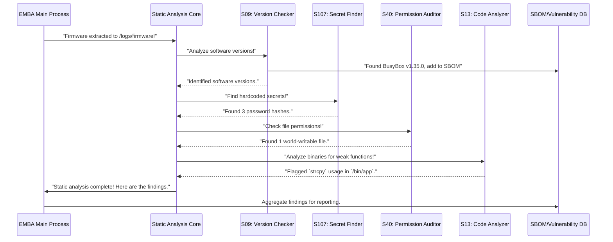

# Chapter 2: Analysis Core

In our first chapter, we learned how EMBA acts like a digital archaeologist, meticulously **extracting** all the hidden layers and components from a firmware image using its [Firmware Extraction Layer](The-EMBA-book-‐-Chapter-1%3A-Firmware-Extraction-Layer). Now, you have a pile of extracted files: program code, configuration settings, and various data files. But what do you do with them? How do you find out if they contain any hidden dangers?

This is where EMBA's **Static Analysis Core** comes into play. Imagine you've extracted all the pieces of a mysterious puzzle. You don't want to just blindly assemble it; you first want to carefully examine each piece for clues, markings, or potential flaws without putting it together. The Static Analysis Core does exactly that for your firmware.

Our central goal in this chapter is to understand *how EMBA automatically scrutinizes these extracted files, searching for security weaknesses and crucial information, all without ever running a single line of the firmware's original code*.

### What is Static Analysis?

At its heart, **static analysis** is the process of examining software code and configurations *without executing them*. Think of it like a forensic examiner reviewing a crime scene: they gather evidence, analyze fingerprints, and inspect documents – all without disturbing the scene. They're looking for patterns, inconsistencies, and known issues based on the evidence collected.

This is different from **dynamic analysis** (which we'll cover in the next chapter), where you actually run the software in a controlled environment to observe its behavior. Both are crucial, but static analysis gives you a broad overview and finds many issues quickly and safely.

EMBA's Static Analysis Core is a collection of many specialized "detectives," each looking for specific types of clues in the extracted firmware.

### What Does EMBA's Static Analysis Core Look For?

Once the [Firmware Extraction Layer](https://github.com/e-m-b-a/emba/wiki/The-EMBA-book-%E2%80%90-Chapter-1:-Firmware-Extraction-Layer) has done its job, the Static Analysis Core begins its detailed inspection. Here are some of the key types of "clues" it hunts for:

1.  **Outdated Software Versions**: Devices often use open-source software like web servers (e.g., Lighttpd), BusyBox (a common toolkit for embedded Linux), or the Linux kernel itself. EMBA identifies these components and their versions. Why is this important? Because older versions might have **known vulnerabilities** that attackers could exploit.
2.  **Hardcoded Secrets**: Sometimes, developers accidentally embed sensitive information directly into the firmware's code or configuration files. This could be passwords, API keys, cryptographic keys, or other confidential data. EMBA searches for patterns that indicate such "hardcoded secrets."
3.  **Weak Permissions**: Just like files on your computer, firmware files and folders have permissions that dictate who can read, write, or execute them. If critical system files have "weak" (too permissive) permissions, an attacker might be able to modify them, leading to a compromise.
4.  **Insecure Configuration Files**: Many device services rely on configuration files (e.g., for web servers, SSH, or other network services). EMBA inspects these files for insecure settings, like a web server running as the "root" user (which grants too many privileges) or enabling directory listings that expose sensitive internal files.
5.  **Weak Code Patterns**: Programs are often written in languages like C/C++. Some programming functions are known to be "unsafe" if not used carefully (e.g., `strcpy` can lead to buffer overflows). EMBA looks for the use of such functions in compiled code to flag potential vulnerabilities that require deeper manual review.
6.  **Known Malicious Patterns (YARA)**: EMBA uses YARA rules, which are like digital "fingerprints" for malware or specific vulnerabilities. It scans the entire firmware for these patterns to identify potentially malicious code or known exploits.

### How EMBA Performs Static Analysis (Automatic Process)

As a user, you don't need to manually tell EMBA which static analysis checks to run. Once you provide a firmware file, the process is largely automatic after extraction:

```bash
./emba -f my_router_firmware.bin -l ~/your_log_directory
```

After the extraction phase, EMBA seamlessly transitions into static analysis. You'll see various modules running, each contributing to the overall security picture. The output will gradually reveal findings, like:

```text
[*] Static version detection running ...
[+] Version information found BusyBox v1.35.0 in binary /bin/busybox (license: GPL-2.0-only) (static).
[+] Found 17 issues in script (common linux file: no): /usr/local/bin/my_custom_script.sh
[+] Found 3 password hash values.
```

This output shows EMBA identifying a BusyBox version, flagging issues in a custom script, and finding password hashes. EMBA is designed to be comprehensive, ensuring a wide range of checks are performed.

### Under the Hood: The Static Analysis Process

EMBA's Static Analysis Core isn't one giant program; it's a collection of many smaller, specialized tools (called "modules" in EMBA). Each module is designed to perform a specific type of analysis very efficiently.

Here's a simplified view of how the Static Analysis Core operates after firmware extraction:



Let's look at a few examples of these "specialized detectives" and how they work.

#### 1. Identifying Software Versions (`S09_firmware_base_version_check.sh`)

This module's job is to figure out what software components (like "BusyBox" or "OpenSSL") are present in the firmware and what their versions are. It does this by searching for specific text patterns (like "BusyBox v1.35.0") within the extracted files.

EMBA uses configuration files (like `config/bin_version_identifiers/busybox.json`) that define these patterns using regular expressions (regex).

Here's a very simplified look at how it might find a BusyBox version:

```json
{
  "identifier": "busybox",
  "grep_commands": [
    "\"BusyBox\\ v[0-9](\\.[0-9]+)+?.*\\ multi-call\\ binary\"",
    // ... more grep patterns for BusyBox versions
  ],
  "version_extraction": [
    "\"sed -r 's/BusyBox\\ v([0-9](\\.[0-9]+)+?).*/:busybox:busybox:\\1/'\""
  ]
}
```
This JSON snippet tells EMBA:
*   **`identifier`**: This rule is for "busybox".
*   **`grep_commands`**: These are the text patterns to search for. For example, `"BusyBox\\ v[0-9](\\.[0-9]+)+?.*\\ multi-call\\ binary"` looks for "BusyBox v" followed by numbers (like "1.35.0") and then "multi-call binary".
*   **`version_extraction`**: Once a match is found, this part uses `sed` (a text manipulation tool) to extract just the version number.

The actual script `modules/S09_firmware_base_version_check.sh` first extracts all readable strings from the binary files, then applies these `grep` commands:

```bash
# Simplified from modules/S09_firmware_base_version_check.sh
generate_strings() {
  local binary_path="${1:-}"
  # Extract all printable strings from the binary
  strings "${binary_path}" | uniq > "${LOG_PATH_MODULE}/strings_bins/strings_$(basename "${binary_path}").txt"
}

bin_string_checker() {
  local version_identifier="${1:-}" # e.g., "BusyBox\\ v[0-9](\\.[0-9]+)+?.*\\ multi-call\\ binary"
  local strings_file="${2:-}"       # path to the generated strings file

  # Use grep to find the version pattern in the strings file
  grep -a -E "${version_identifier}" "${strings_file}" | head -1
}
```
`generate_strings` creates a file containing all readable text from a program. `bin_string_checker` then uses `grep` to search this text for the specific version patterns defined in the configuration. If a version is found, it's logged and used for further vulnerability checks.


#### 2. Finding Hardcoded Secrets (`S107_deep_password_search.sh`)

This module specifically looks for patterns that resemble password hashes or other sensitive credentials in the extracted files. It uses a list of regular expressions to detect these patterns.

```bash
# Simplified from modules/S107_deep_password_search.sh
deep_password_search() {
  local password_regex_config="${CONFIG_DIR}/password_regex.cfg"
  local extracted_firmware_path="${FIRMWARE_PATH}"

  # Search all files for patterns defined in password_regex.cfg
  find "${extracted_firmware_path}" -type f -print0 | \
    xargs -r -0 -P 16 -I % sh -c 'grep --color -n -a -E -H -f "${password_regex_config}" "%" || true' \
    > "${TMP_DIR}/pw_hashes.txt"
}
```
This script uses `find` to locate all files in the extracted firmware and then `grep` to search for any text matching the "password patterns" defined in `config/password_regex.cfg`.

#### 3. Checking Weak Permissions (`S40_weak_perm_check.sh`)

This module identifies files that have insecure permissions, such as files that anyone can write to (world-writable) or executables that run with elevated privileges (setuid/setgid).

```bash
# Simplified from modules/S40_weak_perm_check.sh
check_weak_permissions() {
  local firmware_path="${FIRMWARE_PATH}"

  # Find all world-writable files
  find "${firmware_path}" -xdev -type f -perm -o+w -print

  # Find all setuid files (run as owner, usually root)
  find "${firmware_path}" -xdev -user root -perm -4000 -print
}
```
The `find` command with the `-perm` option is very powerful for this. `-o+w` means "writable by others," and `-4000` means "setuid bit set." These findings are critical as they indicate potential pathways for an attacker to gain control or escalate privileges on the device.

#### 4. Binary Hardening Checks (`S12_binary_protection.sh`)

This module uses a tool called `checksec` to determine if a compiled binary has certain security protections enabled. These protections help prevent common attacks like buffer overflows or code injection.

| Protection | Description                                        | Good / Bad |
| :--------- | :------------------------------------------------- | :--------- |
| **RELRO**  | Helps protect against overwriting sensitive data.    | Full / No  |
| **Canary** | Detects stack buffer overflows.                    | Found / No |
| **NX**     | Prevents execution of code from data segments.     | Enabled / Disabled |
| **PIE**    | Makes program memory layout random, harder to attack. | Enabled / No |

Here's how `checksec` is used:

```bash
# Simplified from modules/S12_binary_protection.sh (binary_protection_threader function)
binary_protection_threader() {
  local lBINARY="${1:-}" # Path to the binary file

  # Run checksec tool on the binary and get CSV output
  local lCSV_BIN_OUT=$("${EXT_DIR}"/checksec --format=csv --file="${lBINARY}")

  # Log the results
  echo "${lCSV_BIN_OUT//,/\;}" >> "${lCSV_LOG}"
  # ... (rest of the function for displaying colored output)
}
```

EMBA calls `checksec` for each executable file and logs whether security features like RELRO, Canary, NX, and PIE are enabled. "Full RELRO" and "PIE enabled" are generally good signs!


#### 5. Detecting Weak Code Patterns (`S13_weak_func_check.sh`)

This module dives into the compiled executable files (like `.elf` binaries) to see if they use certain "dangerous" C/C++ functions, such as `strcpy`, `system`, or `sprintf`, which are often associated with buffer overflows or command injection vulnerabilities if not handled correctly.

It uses tools like `objdump` or `readelf` to disassemble the binaries and look for calls to these functions.

```bash
# Simplified from modules/S13_weak_func_check.sh
check_binary_functions() {
  local binary_file="${1:-}"
  local vulnerable_function="${2:-}" # e.g., "strcpy"

  # Use objdump to disassemble the binary and grep for function calls
  objdump -d "${binary_file}" | grep "call.*<${vulnerable_function}>"
}
```
This snippet shows how `objdump -d` is used to get the assembly code of a binary, and then `grep` searches for call instructions to specific vulnerable functions. EMBA will log how many times each function is used, helping analysts prioritize their review.


#### 6. Deeper C/C++ Code Analysis (`S16_ghidra_decompile_checks.sh`):
Sometimes, just looking for function calls isn't enough. For deeper analysis, EMBA can decompile binaries back into human-readable source code using **Ghidra**. This "source code" is an approximation of the original code, but it's good enough for more sophisticated checks. EMBA then uses **Semgrep**, a powerful code analysis tool, to scan this decompiled code for complex vulnerability patterns.

```bash
# Simplified from modules/S16_ghidra_decompile_checks.sh (ghidra_analyzer function)
ghidra_analyzer() {
  local lBINARY="${1:-}" # Path to the binary file

  print_output "[*] Extracting decompiled code with Ghidra"
  # Run Ghidra to decompile the binary and extract source code
  timeout --preserve-status --signal SIGINT "${lGHIDRA_TIMEOUT}" \
    "${GHIDRA_PATH}"/support/analyzeHeadless "${LOG_PATH_MODULE}" \
    "ghidra_${lNAME}" -import "${lBINARY}" -scriptPath "${EXT_DIR}"/ghidra_scripts -postScript Haruspex || true

  if [[ -d /tmp/haruspex_"${lNAME}" ]]; then
    print_output "[*] Semgrep analysis on decompiled code from binary ${ORANGE}${lNAME}${NC}"
    # Run Semgrep on the decompiled source code with specific rules
    semgrep --json --config "${EXT_DIR}"/semgrep-rules-0xdea /tmp/haruspex_"${lNAME}"/* >> "${lSEMGREPLOG}" || true
    # ... (process Semgrep results and log findings)
  fi
}
```


This process is more resource-intensive but can uncover vulnerabilities that simpler string searches might miss.

#### 7. Analyzing Configuration Files (`S36_lighttpd.sh`)

EMBA also examines configuration files for common services like web servers (`lighttpd.conf`). It looks for insecure settings that might expose the device.

```bash
# Simplified from modules/S36_lighttpd.sh
analyze_lighttpd_config() {
  local config_file="${1:-}"

  echo "Checking for root user:"
  grep "user=root" "${config_file}"

  echo "Checking for directory listing:"
  grep "dir-listing.activate.*enable" "${config_file}"
}
```
This simple `grep` approach allows EMBA to quickly identify critical misconfigurations. For example, if a web server is configured to run as `root`, any vulnerability in the web server could lead to full system compromise. Similarly, enabling directory listings can expose sensitive files to attackers.

### Summary of Static Analysis Modules

EMBA has many static analysis modules, each with a specific focus. Here's a table summarizing some of them:

| Module Name                   | What it looks for (Analogy)              | Key Tools/Methods         |
| :---------------------------- | :--------------------------------------- | :------------------------ |
| `S02_UEFI_FwHunt`             | UEFI firmware vulnerabilities            | FwHunt scanner            |
| `S03_firmware_bin_base_analyzer` | General OS and architecture guesses      | `strings`, `binwalk`      |
| `S05_firmware_details`        | Firmware file counts, directory tree, release info | `tree`, `ls`, `grep`     |
| `S06_distribution_identification` | Specific Linux distribution and version  | `grep` with config rules  |
| `S07_bootloader_check`        | Bootloader type and config (e.g., GRUB passwords) | `grep` on config files    |
| `S09_firmware_base_version_check` | Software names and versions (ID card check) | `strings`, `grep`, JSON rules |
| `S10_binaries_basic_check`    | Critical binary function calls (high-level) | `readelf`, `grep`         |
| `S12_binary_protection`       | Binary exploitation mitigations (ASLR, NX) | `checksec`                |
| `S13_weak_func_check`         | Legacy C functions (like `strcpy`) via `objdump` | `objdump`, `grep`         |
| `S14_weak_func_radare_check`  | Legacy C functions (like `strcpy`) via `radare2` | `radare2`, `grep`         |
| `S15_radare_decompile_checks` | Decompiled code for vulnerabilities (`radare2`) | `radare2`, `grep`         |
| `S16_ghidra_decompile_checks` | Decompiled code for vulnerabilities (`Ghidra`, `semgrep`) | `Ghidra`, `semgrep`     |
| `S17_cwe_checker`             | Common Weakness Enumeration (CWE) issues | `cwe-checker`             |
| `S18_capa_checker`            | Binary capabilities/behavior patterns    | `capa`                    |
| `S19_apk_check`               | Android APK security analysis            | APKHunt                   |
| `S20_shell_check`             | Shell script issues (`shellcheck`, `semgrep`) | `shellcheck`, `semgrep`   |
| `S21_python_check`            | Python script issues (`bandit`)          | `bandit`                  |
| `S22_php_check`               | PHP script and config issues             | `progpilot`, `iniscan`, `semgrep` |
| `S23_lua_check`               | Lua script issues (`luacheck`)           | `luacheck`                |
| `S24_kernel_bin_identifier`   | Linux kernel binary and config extraction | `vmlinux-to-elf`, `grep` |
| `S25_kernel_check`            | Linux kernel version, modules, exploit suggestions | `modinfo`, `linux-exploit-suggester` |
| `S27_perl_check`              | Perl script issues (`zarn`)              | `zarn`                    |
| `S35_http_file_check`         | Web server files (Apache, Nginx, Lighttpd) | `grep`, `find`            |
| `S36_lighttpd`                | Lighttpd web server configuration hardening | `grep` on config files    |
| `S40_weak_perm_check`         | Weak file permissions (setuid, world-writable) | `find -perm`              |
| `S45_pass_file_check`         | Password files, root accounts, cleartext passwords | `grep`                    |
| `S50_authentication_check`    | User/group/PAM/sudoer configs, UID 0 accounts | `grep`, `sudo-parser.pl`  |
| `S55_history_file_check`      | Shell history files                      | `find`                    |
| `S60_cert_file_check`         | Certificates and their expiration dates  | `openssl`                 |
| `S65_config_file_check`       | General config files, fstab with credentials | `find`, `grep`            |
| `S75_network_check`           | Network configurations (DNS, iptables, SNMP) | `grep`                    |
| `S80_cronjob_check`           | Cron jobs, world-writable cron entries   | `find`, `grep`            |
| `S85_ssh_check`               | SSH configs, XZ backdoor, Squid proxy    | `grep`, `ldd`, `sshdcc`   |
| `S90_mail_check`              | Mailbox files                            | `find`, `head`            |
| `S95_interesting_files_check` | Compiler tools, hidden files, post-exploitation tools | `find`, `file`            |
| `S99_grepit`                  | Generic search for interesting patterns  | `grep` with rules         |
| `S100_command_inj_check`      | Web scripts susceptible to command injection | `grep` with patterns      |
| `S106_deep_key_search`        | Deep search for sensitive key material   | `grep` with regex patterns|
| `S107_deep_password_search`   | Deep search for password hashes          | `grep` with regex patterns|
| `S108_stacs_password_search`  | Deep search for password patterns (`stacs`) | `stacs`                   |
| `S109_jtr_local_pw_cracking`  | Cracks identified password hashes        | `john`                    |
| `S110_yara_check`             | Known malicious patterns (Digital fingerprints) | `yara` rules             |

### Conclusion

The Static Analysis Suite is EMBA's comprehensive "X-ray vision" and the powerhouse of non-intrusive investigation of firmware. By meticulously examining extracted files without ever executing them, it efficiently identifies outdated software, checks for binary security protections, pinpoints weak coding practices in various languages, and uncovers hidden secrets. This crucial phase provides a foundational understanding of the firmware's security posture before any dynamic testing even begins.

Now that we understand how EMBA thoroughly examines firmware *without* running it, our next step is to explore how it analyzes behavior *by* running the firmware in a safe, controlled environment. This is where the powerful techniques of [Dynamic Analysis & Emulation](https://github.com/e-m-b-a/emba/wiki/The-EMBA-book-%E2%80%90-Chapter-3:-User-Mode-Emulation) come into play.