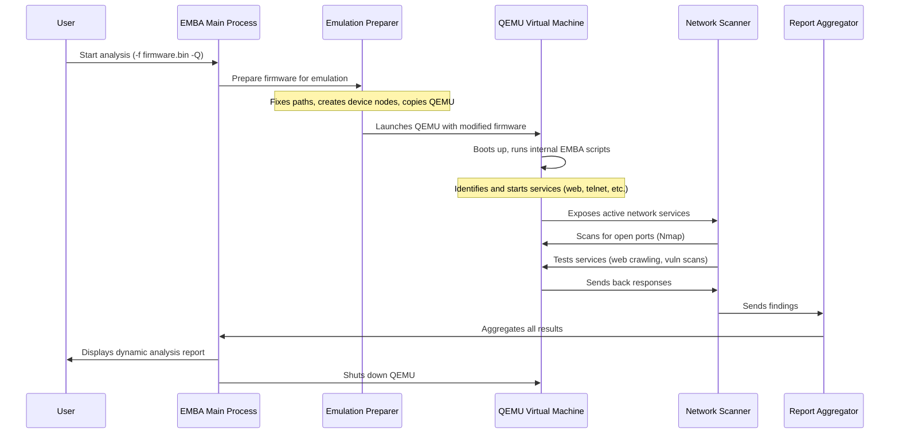

# Chapter 4: System Emulation & Dynamic Analysis

In our previous chapters, we first saw how EMBA acts like a digital detective, **extracting** all the hidden parts from a firmware image ([Firmware Extraction Layer](The-EMBA-book-‐-Chapter-1%3A-Firmware-Extraction-Layer)). Then, we learned how it meticulously **scrutinizes** these extracted files without running them, a process called [Analysis Core](The-EMBA-book-‐-Chapter-2%3A-Analysis-Core). Static analysis is powerful for finding issues in the code itself, like hardcoded passwords or outdated software versions.

But what if a vulnerability only shows up when the device is actually running? Imagine you're looking at a car's blueprint. Static analysis can tell you if a part is missing or if a design flaw exists. But to know if the engine actually starts, if the brakes work, or if it handles well on the road, you need to *drive* it.

This is where EMBA's **Dynamic Analysis & Emulation** layer comes in! It's like setting up a virtual test track for your firmware. Instead of just inspecting the parts, EMBA carefully runs the firmware in a safe, controlled environment. This allows it to interact with live services, observe network behavior, and actively test for vulnerabilities that only appear during actual operation.

Our central goal in this chapter is to understand *how EMBA virtually "boots up" the firmware, observes its real-world behavior, and actively identifies issues like open network ports or exploitable network services that static analysis might miss*.

### What is Dynamic Analysis & Emulation?

At its heart, **Dynamic Analysis** is the process of examining software *while it is running*. This lets us see how it behaves in a live environment, how it interacts with networks, and what services it exposes.

To do this for firmware (software designed for specific hardware like a router's chip), EMBA uses **Emulation**. Emulation means creating a virtual environment that mimics the original hardware. This is typically done using a powerful tool called **QEMU**. Think of QEMU as a special program that can pretend to be a different kind of computer, allowing firmware built for, say, an ARM-based router to run on your regular Intel or AMD computer.

This entire process happens within a **sandbox** – an isolated, secure environment. This is crucial because we're running potentially buggy or vulnerable software, and we don't want it to affect our host computer.

### What Problems Does Dynamic Analysis Solve?

While static analysis gives us a great head start, it has limitations. Dynamic analysis helps us uncover issues such as:

*   **Live Open Ports**: Which network ports are actually open and listening for connections once the device boots up?
*   **Running Services**: What web servers, FTP servers, Telnet services, or other network services are active?
*   **Default Credentials**: Are there any default usernames and passwords active on live services that an attacker could easily guess?
*   **Network Behavior**: How does the device try to connect to the internet? Does it use DNS? Does it send out suspicious traffic?
*   **Runtime Vulnerabilities**: Issues that only manifest when certain code paths are executed or specific network conditions are met.

### How EMBA Performs Dynamic Analysis (User Perspective)

As an EMBA user, enabling dynamic analysis is straightforward. After you've provided your firmware file, you just need to add a flag:

```bash
./emba -f my_router_firmware.bin -Q
```

The `-Q` flag tells EMBA to enable its full system emulation and dynamic analysis capabilities. When you run this, EMBA will first extract the firmware (Chapter 1) and perform static analysis (Chapter 2). Then, it will start the emulation. You'll see output indicating that QEMU is starting and network checks are being performed:

```text
[*] Starting system emulation ...
[+] System is online: 192.168.0.1
[*] Nmap portscans for emulated system with IP 192.168.0.1
[+] Service detected: 80/tcp http
[+] Web server on IP 192.168.0.1:80 created screenshot: screenshot_192.168.0.1_80.png
[+] Vulnerability identified for module auxiliary/scanner/vnc/vnc_none_auth
```

This output shows EMBA successfully booting the virtual system, identifying its IP address, finding an HTTP service on port 80, taking a screenshot of the web interface, and even detecting a potential vulnerability in a VNC service!

### Under the Hood: The Dynamic Analysis Process

EMBA's dynamic analysis is complex because it involves running an entire operating system within a virtual machine. It's built upon the excellent work of projects like Firmadyne and FirmAE. Here's a simplified look at the steps:



Let's break down some of the key actions EMBA takes:

#### 1. System Emulation (`L10_system_emulation`)

This is the core module that sets up and runs the entire firmware in a virtual machine. EMBA uses QEMU to create a full system environment. Firmware images aren't always designed to be easily booted on a different system, so EMBA performs many "fixes" to make them work.

*   **Preparing the Filesystem:** Firmware often expects specific files or device nodes (like `/dev/null` or `/dev/tty`) to exist. EMBA ensures these are present and correctly configured. The `fixImage.sh` script, originating from the Firmadyne project, is responsible for this.

    ```bash
    # From modules/L10_system_emulation/fixImage.sh (simplified)
    # Recreate essential device nodes
    "${BUSYBOX}" mknod -m 666 /dev/null c 1 3
    "${BUSYBOX}" mknod -m 622 /dev/console c 5 1

    # Create common directories
    mkdir -p "$(resolve_link /etc)"
    mkdir -p "$(resolve_link /var)"
    mkdir -p "$(resolve_link /run)"

    # Add a default root password (for easier debugging)
    # nosemgrep
    echo "root::0:0:root:/root:/bin/sh" > "$(resolve_link /etc/passwd)"

    # Prevent reboots during analysis
    rm -f /sbin/reboot
    echo '#!/bin/sh' > /sbin/reboot
    echo 'echo "[*] System tries to reboot - reboot not executed"' >> /sbin/reboot
    chmod +x /sbin/reboot
    ```
    This snippet shows how EMBA creates vital system files, adds a default root user (which helps with later interactive debugging), and even prevents the emulated system from rebooting, ensuring continuous analysis.

*   **Starting Services:** The firmware doesn't just "start" all its services automatically in a new environment. EMBA has clever scripts (`inferService.sh`, `run_service.sh`) that try to figure out which services should run and how to launch them, often by parsing configuration files or looking for common executable names.

    ```bash
    # From modules/L10_system_emulation/inferService.sh (simplified)
    for BINARY in $("${BUSYBOX}" find / -name "*lighttpd" -o -name "upnpd" \
      -o -name "*telnetd" -o -name "httpd"); do # ... and many more
      if [ -x "${BINARY}" ]; then # Check if executable
        SERVICE_NAME=$("${BUSYBOX}" basename "${BINARY}")
        # Add to the list of services to start
        if ! "${BUSYBOX}" grep -q "${BINARY}" /firmadyne/service 2>/dev/null; then
          "${BUSYBOX}" echo -e "[*] Writing EMBA process starter for ${ORANGE}${BINARY}${NC}"
          "${BUSYBOX}" echo -e -n "${BINARY}\n" >> /firmadyne/service
        fi
      fi
    done

    # Add debugging services like Netcat/Telnet listeners for manual access
    "${BUSYBOX}" echo -e -n "/firmadyne/netcat -nvlp 9876 -e /firmadyne/sh\n" >> /firmadyne/service
    "${BUSYBOX}" echo -e -n "/firmadyne/busybox telnetd -p 9877 -l /firmadyne/sh\n" >> /firmadyne/service
    ```
    This script actively searches for common web servers (like `lighttpd`), UPnP daemons, and other services. It then adds commands to a special `firmadyne/service` file, which tells EMBA's `run_service.sh` how to start them. It even adds backdoor Telnet/Netcat listeners for analysts to interact with the emulated system later!

*   **Checking System Health:** EMBA constantly monitors if the emulated system is still alive and responsive, usually by pinging its virtual IP address. If it goes down, EMBA tries to restart it automatically.

    ```bash
    # From helpers/helpers_emba_system_emulation.sh (simplified)
    ping_check() {
      local lIP_ADDRESS="${1:-}"
      local lCOUNTER=0
      while ! ping -c 1 "${lIP_ADDRESS}" &> /dev/null; do
        print_output "[*] Waiting for restarted system ..." "no_log"
        ((lCOUNTER+=1))
        if [[ "${lCOUNTER}" -gt 50 ]]; then
          print_output "[-] System not recovered" "no_log"
          break # Give up after too many retries
        fi
        sleep 6 # Wait a bit before retrying
      done
      # ... (handle success or failure)
    }
    ```
    This `ping_check` function is a simple but effective way to determine if the emulated device is responding to network requests.

#### 2. Network & Service Scanning (`L15_emulated_checks_nmap`)

Once the emulated system is up and running, EMBA uses standard network scanning tools to discover open ports and services, just like an attacker would. The primary tool here is `Nmap`.

```bash
# From modules/L15_emulated_checks_nmap.sh (simplified)
check_live_nmap_basic() {
  local lIP_ADDRESS="${1:-}"
  # ... (check if system is online)

  # Perform a comprehensive Nmap scan
  nmap -Pn -n -sSV -A --host-timeout 30m "${lIP_ADDRESS}" \
    -oA "${LOG_PATH_MODULE}"/nmap-basic-"${lIP_ADDRESS}" | tee -a "${LOG_FILE}"

  # Extract service details from Nmap output
  mapfile -t NMAP_PORTS_SERVICES_ARR < <(grep -h -a "open" \
    "${LOG_PATH_MODULE}"/*.nmap | awk '{print $1,$3}' | grep "[0-9]" | sort -u)

  # ... (further processing of Nmap results)
}
```
`Nmap` (`-sSV` for service/version detection, `-A` for aggressive scan) helps EMBA identify exactly what services are running on which ports. The output is then parsed to extract service names and versions.

#### 3. Web Service Checks (`L25_web_checks`)

For identified web services (HTTP/HTTPS), EMBA goes a step further, performing automated web crawling, SSL certificate checks, and common vulnerability scans.

```bash
# From modules/L25_web_checks.sh (simplified)
web_access_crawler() {
  local lIP_="${1}"
  local lPORT_="${2}"
  local lSSL_="${3}"
  local lPROTO="" # http or https
  # ... (set protocol based on lSSL_)

  # Try to access common web paths using curl
  curl -sS --noproxy '*' "${lPROTO}://${lIP_}:${lPORT_}/index.html" -o /dev/null -w '%{http_code}'
  curl -sS --noproxy '*' "${lPROTO}://${lIP_}:${lPORT_}/admin/" -o /dev/null -w '%{http_code}'
  # ... many more common paths

  # Take a screenshot using a headless browser
  "${CHROME_HEADLESS_BIN}" --no-sandbox --screenshot="screenshot.png" \
    "${lPROTO}://${lIP_}:${lPORT_}" 2>/dev/null
}

testssl_check() {
  local lIP_="${1:-}"
  local lPORT="${2:-}"
  # Run testssl.sh for SSL/TLS configuration analysis
  "${EXT_DIR}"/testssl.sh/testssl.sh "${lIP_}":"${lPORT}" | tee -a "${LOG_PATH_MODULE}"/testssl-"${lIP_}"-"${lPORT}".txt
}

# Nikto web scanner
"${EXT_DIR}"/nikto/program/nikto.pl -ssl -port "${lPORT}" -host "${lIP_ADDRESS_}"
```
EMBA attempts to access common web pages (`index.html`, `/admin`), performs a comprehensive `testssl.sh` scan to check for weak SSL/TLS configurations, and runs `Nikto` to identify known web server vulnerabilities and misconfigurations. It also tries to capture a screenshot of the web interface!

#### 4. Active Exploitation & Vulnerability Verification (`L35_metasploit_check`)

For critical vulnerabilities, EMBA can even attempt to *actively exploit* the emulated system using the Metasploit Framework. This is done in a safe sandbox, so there's no risk to your actual network.

```ruby
# From helpers/l35_msf_check.rc (Metasploit Resource Script - simplified)
def exploit_checker(host,ports,architecture)
  print_status("Checking host #{host} with identified ports #{ports}...")
  framework.exploits.each { |name,mod|
    mod = framework.modules.create("#{name}")
    # ... (filter modules to run)
    ports.split(",").each { |serv|
      # ... (set RHOST, RPORT, PAYLOAD)
      print_status("Checking #{name} against host #{host.to_s}:#{serv} ...")
      result = mod.check_simple({'RunAsJob': true}) # Run check function
      if result.to_s =~ /Vulnerable/ # If found vulnerable, then exploit
        print_good("Vulnerability identified for module #{name}")
        mod.exploit_simple({'RunAsJob': true}) # Attempt exploitation
      end
    }
  }
end
# ... (main part calls exploit_checker)
```
This simplified Ruby script, run by Metasploit, iterates through various exploit modules, first checking if the target is vulnerable, and then attempting to exploit it. This provides definitive proof of a vulnerability if a "session" (like a remote shell) can be opened on the emulated device.


### Summary of Dynamic Analysis & Emulation Modules

EMBA leverages several modules for its dynamic analysis, each contributing to a complete picture of the firmware's runtime behavior and vulnerabilities:

| Module Name                   | Purpose (Analogy)                                  | Key Tools/Methods           |
| :---------------------------- | :------------------------------------------------- | :-------------------------- |
| `L10_system_emulation`        | **Boots the entire firmware as a virtual device.** This is the foundation for live testing, creating a network-accessible environment. | `QEMU` (system mode), custom `fixImage.sh` and `inferService.sh` scripts |
| `L15_emulated_checks_nmap`    | **Scans the live virtual system for open ports and services.** Finds what's actually listening. | `Nmap`                      |
| `L20_snmp_checks`             | **Tests SNMP services** (if found) for common vulnerabilities and information disclosure. | `snmp-check`, `snmpwalk`    |
| `L22_upnp_hnap_checks`        | **Tests UPnP, HNAP, and JNAP services** (if found) for insecure configurations or accessible endpoints. | `upnpc`, `curl`             |
| `L23_vnc_checks`              | **Tests VNC services** (if found) for weak authentication or other flaws. | `Nmap` scripts, `Metasploit` modules |
| `L25_web_checks`              | **Crawls and scans identified web servers** for common vulnerabilities, misconfigurations, and takes screenshots. | `curl`, `Nikto`, `testssl.sh`, `chrome-headless-shell` |
| `L35_metasploit_check`        | **Actively exploits identified open services.** Provides proof of concept for critical vulnerabilities in the sandbox. | `Metasploit Framework`      |
| `L99_cleanup`                 | **Safely shuts down** all emulated instances and cleans up temporary files. | `pkill`, `umount`, `rm`     |

### Conclusion

The Dynamic Analysis & Emulation layer is a critical component of EMBA's comprehensive security assessment. By harnessing the power of QEMU and a suite of specialized tools, EMBA can "bring the firmware to life" in a safe, controlled environment. This allows it to discover vulnerabilities and gather vital information that only manifest during runtime, providing a deeper and more accurate security posture than static analysis alone.

[Chapter 5: SBOM and vulnerability aggregation](The-EMBA-book-‐-Chapter-5%3A-SBOM-and-vulnerability-aggregation) proceeds with building up a SBOM of the collected data.